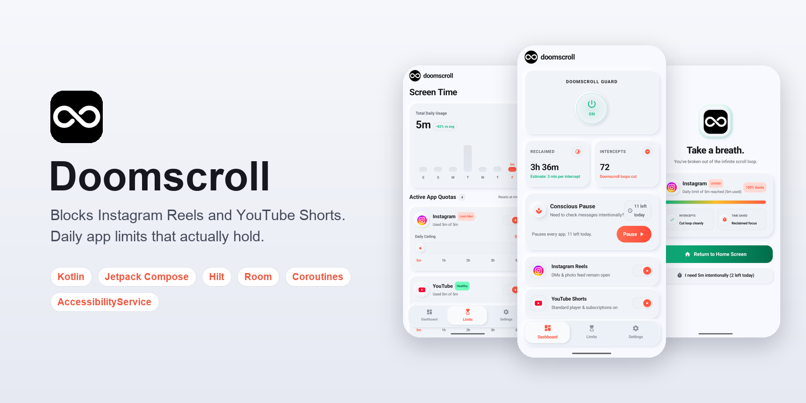
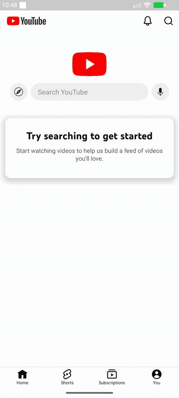
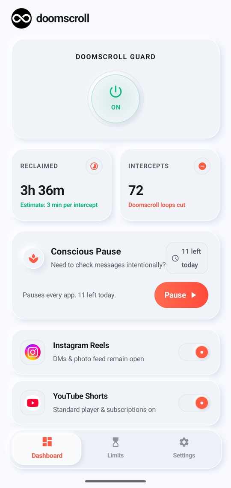
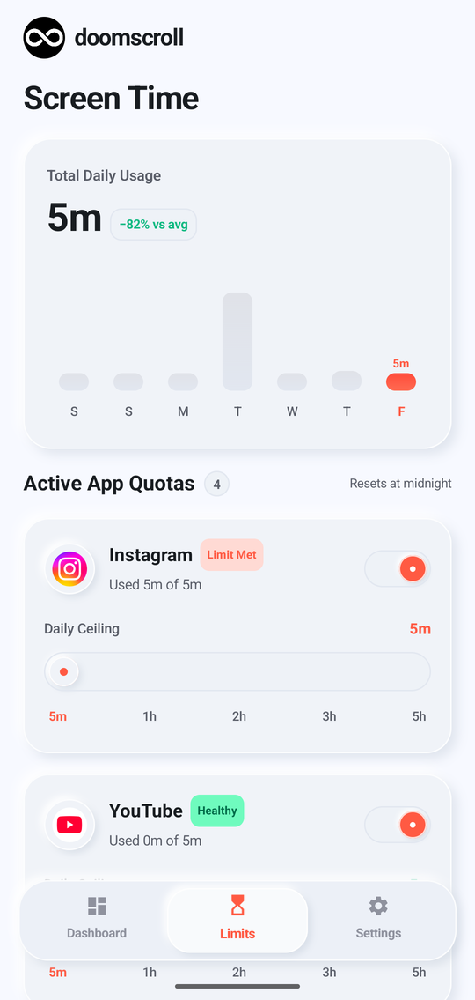
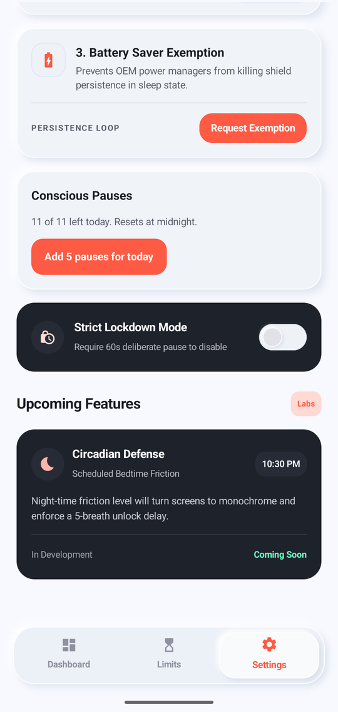
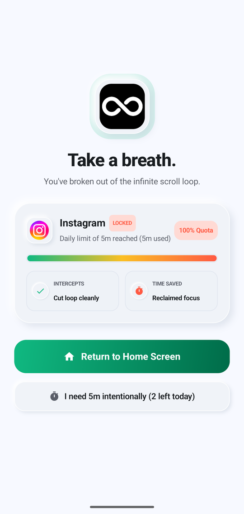
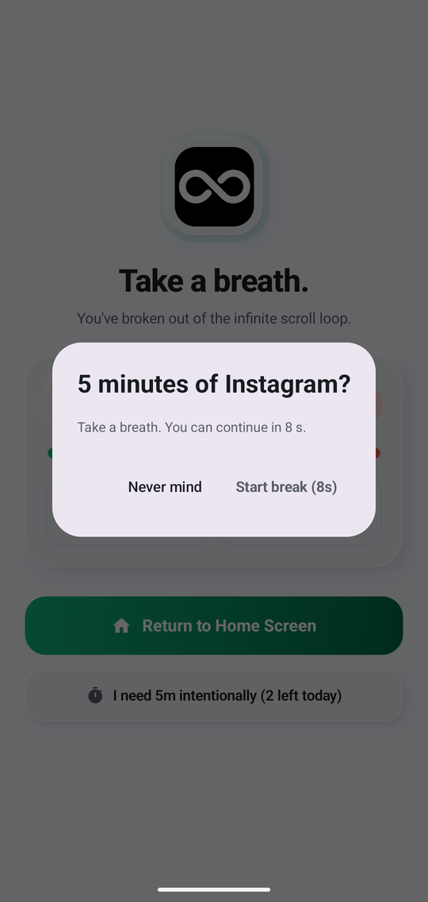
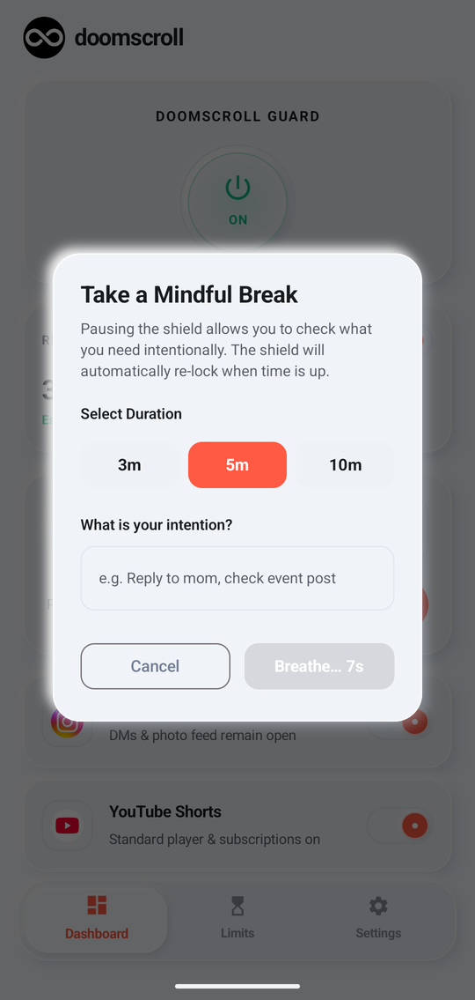
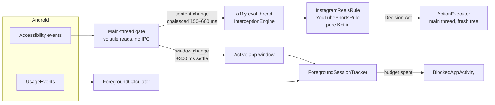

<p align="center">
  
</p>

<p align="center">
  
  
  
  
  
  
  <a href="LICENSE"></a>
</p>

# Doomscroll

**An Android app that stops short-form video from eating your day.** Doomscroll removes Instagram Reels
and YouTube Shorts from those apps while leaving the rest usable (DMs, Stories, the photo feed,
subscriptions, normal videos). It also enforces daily time limits that hold up mid-session.

It runs entirely on the device through an Android `AccessibilityService` and `UsageStatsManager`.
It has no backend and no account, and doesn't even declare the `INTERNET` permission.

<table>
  <tr>
    <td width="300" align="center">
      
    </td>
    <td>
      <h3>What it looks like</h3>
      <p>Tap <b>Shorts</b> in YouTube and you're back on Home within a moment.
      Tap it again and the same thing happens. Repeated attempts never wear the blocker down
      (that was a real bug once; see <a href="#engineering-highlights">Engineering highlights</a>).</p>
      <p>On Instagram the Reels tab sends you to the home feed, and a Reel opened from the feed,
      Explore, a profile or search gets closed with the app's own Back button. DMs, Stories and the
      camera are exempt.</p>
      <p><sub>Recorded on an Android emulator with a signed-out YouTube 21.42. The Short is blurred.</sub></p>
    </td>
  </tr>
</table>

## Screenshots

<table>
  <tr>
    <td align="center"><br/><b>Dashboard</b><br/><sub>Master shield, today's intercepts, Conscious Pause</sub></td>
    <td align="center"><br/><b>Limits</b><br/><sub>Real usage from <code>UsageEvents</code>, per-app daily ceilings</sub></td>
    <td align="center"><br/><b>Settings</b><br/><sub>Extra pauses after a 60 s wait, Strict Lockdown</sub></td>
  </tr>
  <tr>
    <td align="center"><br/><b>Block screen</b><br/><sub>Shown the moment a daily budget runs out</sub></td>
    <td align="center"><br/><b>Emergency break</b><br/><sub>Rationed, with a wait that grows each time</sub></td>
    <td align="center"><br/><b>Conscious Pause</b><br/><sub>10 s breathe and a typed intention first</sub></td>
  </tr>
</table>

<p align="center"><sub>Screenshots from a Pixel 7 running the debug build, with real data.</sub></p>

## Features

- **Surgical blocking.** Reels and Shorts are removed. The rest of Instagram and YouTube keeps working.
- **Daily limits that actually fire.** Per-app budgets (5 min to 5 h) for Instagram, YouTube,
  TikTok, Reddit and X. The block screen appears the moment you run out, even if you never leave the app.
- **Friction, not walls.** Every way out costs a little time and a conscious choice, and is rationed:

  | Escape hatch | Rule |
  | --- | --- |
  | Emergency break (block screen) | 2 per app per day, 5 min. Wait 10 s, then 20 s more for each earlier break that day. Typed intention from the 2nd. |
  | Conscious Pause (dashboard) | Pauses every app for 3, 5 or 10 min. 10 per day, after a 10 s breathe and a typed intention. Settings adds 5 more after a 60 s wait. |
  | Turning the shield off | 10 s wait. Turns itself back on after 60 min. |
  | Strict Lockdown | No breaks, pauses or shield-off at all. Turning it off takes a 60 s wait. |

- **Allowances you can't reset.** Counts are persisted, reset at local midnight, and excluded from
  backups so a restore can't refill them.
- **Honest numbers.** Usage comes from raw system events. Intercepts are counted per day in Room.
  "Time reclaimed" is labelled as an estimate (3 min per intercept), and empty states replace placeholder data.
- **Countdown notification** during a break. Tap it to end the break early.

## How it works



**Interception.** Every accessibility event first hits a cheap gate on the main thread (volatile
reads only). Content changes are coalesced and evaluated on a dedicated `HandlerThread`. Each
platform is an `InterceptionRule`, a pure function from a `Screen` to a `Decision` (`Pass`,
`RetryAfter` or `Act`). Rules never touch the UI themselves. `ActionExecutor` carries out the
action against a freshly fetched node tree. Adding a platform means adding a rule class and its
view IDs. The service doesn't change.

**Limits.** The foreground app comes from the *active application window*, resolved 300 ms after a
window change. `ForegroundCalculator` computes today's usage from raw `UsageEvents`.
`ForegroundSessionTracker` then schedules one coroutine for the exact second the budget runs out,
rechecking at least 15 s apart until usage really reaches the limit. The tracker re-syncs whenever
the shield, a limit, a per-app toggle or a break changes.

**Block screen.** `BlockedAppActivity` runs as an isolated `singleInstance` task outside recents. It
launches with `NEW_TASK | CLEAR_TOP` and no Home press first, because pressing Home first makes the
system trim the block screen's task immediately.

## Engineering highlights

Problems found while testing on a real phone, and what fixed them:

**1. Detection cost 130–140 ms per event on Instagram's feed.** Walking the accessibility tree
node by node means one IPC call per node. `Screen` now looks view IDs up lazily with
`findAccessibilityNodeInfosByViewId`, which runs *inside the target app's process*, and memoises
them. A typical check is now a few lookups, and feed scrolling no longer triggers the
slow-evaluation backoff (`EvalThrottle`, which widens the coalescing window from 150 ms up to 600 ms
after three evaluations over 50 ms).

**2. Users could wear the blocker down.** The first loop protection treated three interceptions in
10 s as a loop and stood down, so tapping Reels 3–4 times let a Reel play. A later "escalate to
Home" safeguard closed Instagram when a user opened Reels three times. Now `InterceptionEngine`
**never returns `Pass` while short-form content is on screen**. Inside its 1 s action cooldown it
returns `RetryAfter`, and the service re-evaluates, because a playing video may emit no further
events. Every bypass found becomes a case in `ReelsBypassTest`. Verified on a Pixel 7: six rapid
taps on Reels all end on the home feed.

**3. Limits only fired when an app was opened.** Open Instagram with one minute left and you could
scroll forever. The session tracker above now blocks mid-session. It is Android-free and tested
with virtual time (`runTest` plus an injected `Clock`).

**4. Usage numbers were wrong.** `queryUsageStats(INTERVAL_DAILY)` returns whole buckets that
overlap the requested range and roll over on the system's schedule, not at local midnight.
`ForegroundCalculator` rebuilds sessions from raw resume/pause/screen-off events instead. Finished
days are saved to Room once, so history survives the system's event retention.

**5. `event.packageName` lies about the foreground app.** Launcher animations, system UI and the
keyboard all emit window events while you are still in Instagram, which ended sessions early. The
service now asks for the active `TYPE_APPLICATION` window after the transition settles.

**6. Back buttons in any language.** Closing a Reel uses Instagram's own Back control. It is found
by view ID first, then by the app's *own* localised "Back" / "Navigate up" / "Close" strings read
from its resources (cached per version code), then system Back as a last resort.

## Architecture

Clean layering with a pure-Kotlin domain. `DomainLayeringTest` **fails the build** if anything
under `domain/` imports `android.*`, `androidx.*`, UI, service or persistence code.

| Package | Responsibility |
| --- | --- |
| `domain/` | Every decision: interception rules, limit and break policy, shield auto-resume. Pure Kotlin. Platform access goes through interfaces (`Enforcer`, `BreakStateStore`, `PermissionChecker`). |
| `core/` | Models, `LimitPolicy`, `ForegroundCalculator`, time helpers. |
| `data/` | DataStore for settings and break allowances (separate file, excluded from backup). Room for daily block counts and usage history. Repository implementations. |
| `service/` | `DoomscrollAccessibilityService`, `ForegroundSessionTracker`, `ActionExecutor`, `UsageLimitEnforcer`. |
| `ui/` | Jetpack Compose screens and `@HiltViewModel`s with an MVI-style `UiState` and intents. ViewModels never hold a `Context`. |
| `di/` | Hilt `AppModule`. |

- **Unidirectional data flow:** one source of truth in DataStore or Room, derived with `map` and
  `combine`, exposed as `StateFlow`.
- **Structured concurrency:** service scope, an `@ApplicationScope` and `viewModelScope`. No `GlobalScope`.
- **Testable time:** everything with day or deadline logic takes an injected `java.time.Clock`.
- **Compose performance:** neumorphic shadows are drawn with cached paints in `drawWithCache`.
  Sliders keep a draft and write to disk only when released.

## Testing

```bash
./gradlew testDebugUnitTest
```

64 JVM unit tests cover the logic that matters. There is no emulator dependency.

- **Interception rules** run against in-memory view trees (`Screen(pkg, root)`), including
  regression cases for each bypass found (`ReelsBypassTest`, `RuleEvaluationTest`).
- **Session tracking** uses `kotlinx-coroutines-test` virtual time, with a clock that follows the
  scheduler (`ForegroundSessionTrackerTest`).
- **Usage accounting** covers overlapping activities, sessions crossing midnight, screen-off and
  lock-screen events (`ForegroundCalculatorTest`).
- **Break policy, migrations, metrics and auto-resume** each have their own suite, built on shared
  fakes in `TestFakes.kt`.

## Tech stack

| | |
| --- | --- |
| Language | Kotlin 2.0, Coroutines and Flow |
| UI | Jetpack Compose, Material 3, Navigation Compose |
| DI | Hilt (KSP) |
| Storage | Jetpack DataStore, Room |
| Platform | `AccessibilityService`, `UsageStatsManager` / `UsageEvents`, notifications |
| Build | Gradle Kotlin DSL, version catalog, R8 with resource shrinking |
| Targets | `minSdk 26`, `targetSdk 35`, Java 17 |

## Build and run

Requirements: JDK 17 and the Android SDK (API 35).

```bash
./gradlew assembleDebug      # app/build/outputs/apk/debug/app-debug.apk
./gradlew assembleRelease    # R8-minified; signed only if a release key is configured
```

Release signing is read from `~/.gradle/gradle.properties` (`DOOMSCROLL_STORE_FILE`,
`DOOMSCROLL_STORE_PASSWORD`, `DOOMSCROLL_KEY_ALIAS`, `DOOMSCROLL_KEY_PASSWORD`) and skipped when absent.

After installing, the **Settings** tab walks you through the permissions:

| Permission | Why |
| --- | --- |
| Accessibility service | Detects the Reels and Shorts screens and performs the Back or tab tap. |
| Usage access | Measures daily foreground time for the apps you limit. |
| Notifications | Shows the countdown while a break is running. |
| Battery optimisation exemption (optional) | Keeps aggressive OEM task killers from stopping the service. |

## Privacy

Everything happens on the phone. The app declares no `INTERNET` permission, so nothing can leave
the device. The accessibility service looks for specific view IDs and selection states in the
monitored apps, plus the app's own Back button label. It doesn't read messages, record the screen
or store screen content.

## Limitations and roadmap

- **View IDs belong to Meta and Google** and can change with any app update. The rules are unit
  tested, and fixture capture from real devices is designed (see the remediation doc) but not built
  yet. For example, YouTube 21.42 no longer exposes an ID on the Shorts tab, so detection there
  relies on the Shorts player check, which still catches it.
- TikTok, Reddit and X get daily limits only. There is no in-app section blocking for them.
- There are no instrumented UI tests yet. Coverage comes from JVM tests and checks on a real device.
- Next: a Google Play release (target SDK 36, a prominent accessibility disclosure) and more
  short-form surfaces.

## Design docs

The rewrite was planned before it was coded:

- [`docs/architecture-review.md`](docs/architecture-review.md) audits the first version: 32
  findings (R1–R32) ranked P0–P3, covering correctness, bypasses, performance and Play policy.
- [`docs/remediation-design.md`](docs/remediation-design.md) holds the designs (D1–D10) that fixed them.
- [`AGENTS.md`](AGENTS.md) records the architecture invariants and product rules for contributors,
  human or AI.

Code comments cite these IDs wherever a line exists because of a finding (for example the R4 fix in
`InstagramReelsRule`), so a change can be traced back to the problem that motivated it.

## License

Released under the [MIT License](LICENSE). The license covers the source code. It doesn't grant the
right to use the Doomscroll name or logo to identify another app.
